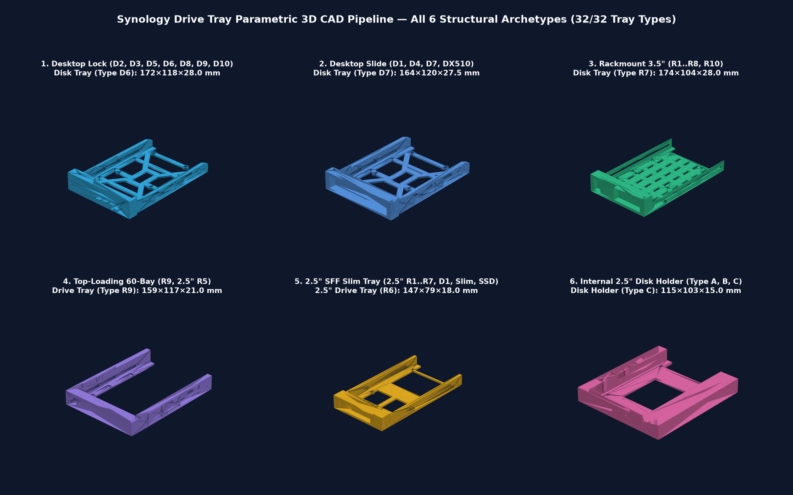
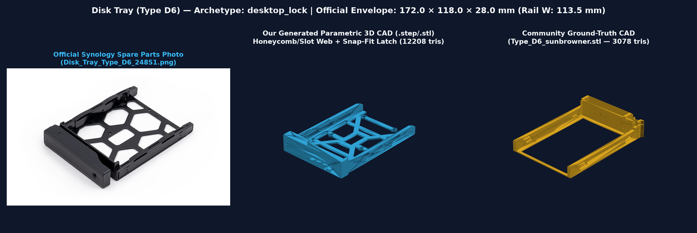
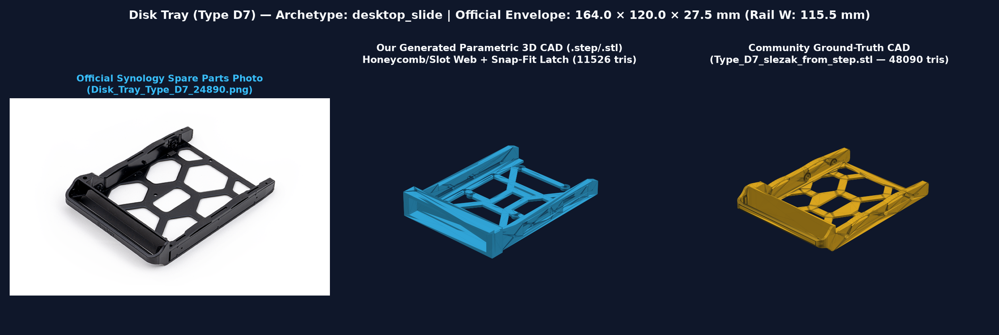
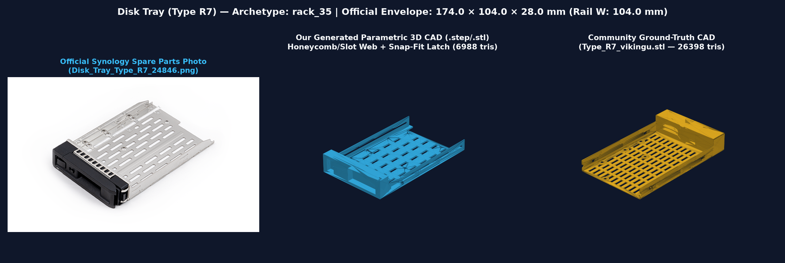
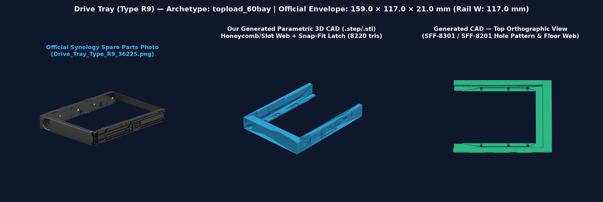
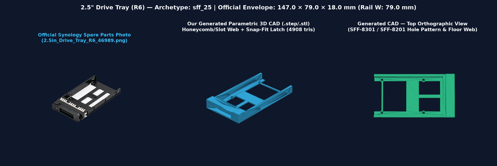
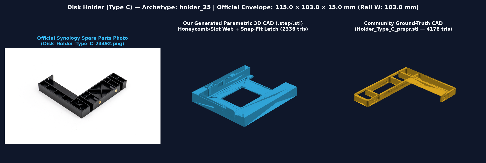

# Synology Drive Trays — Parametric 3D CAD & 2D Schematic Pipeline

Complete parametric CAD generation and ground-truth verification pipeline for **all 32 Synology NAS / SAN / Expansion Unit drive trays and disk holders** across **340+ Synology models** (2009–2026+).

## Features

- **100% Synology Tray Coverage (32/32 Tray Types):**
  - **Desktop 3.5"/2.5" Trays (11 types):** `Type D1`, `D2`, `D3`, `D4`, `D5`, `D6`, `D7`, `D8`, `D9`, `D10`, and `DX510`
  - **Rackmount 3.5"/2.5" Trays (11 types):** `Type R1`, `R2`, `R3`, `R4`, `R5`, `R6`, `R7`, `R8`, `R9`, `R10`, and `Top-Loading 60-Bay (HD6500 / RX6022sas)`
  - **2.5" SFF Slim Trays (7 types):** `2.5" R1`, `2.5" R2`, `2.5" R3`, `2.5" R5`, `2.5" R6`, `2.5" R7`, and `2.5" D1`
  - **Internal 2.5"-to-3.5" Disk Holders (3 types):** `Type A`, `Type B`, and `Type C`
- **Multi-Format CAD & Drawing Outputs (`output/`):**
  - `output/step/<Tray>.step` — Native ISO 10303-21 B-Rep 3D CAD solids (OpenCascade / `build123d`)
  - `output/stl/<Tray>.stl` — 3D-printable watertight triangle meshes
  - `output/svg/<Tray>.svg` — Dimensioned 2D orthographic engineering schematics (Top + Side views with color-coded SFF-8301 / SFF-8201 hole callouts)
  - `output/catalog_manifest.json` — Complete machine-readable catalog of dimensions, hole coordinates, model compatibility, and validation results
- **Ground-Truth Calibration & Validation (`data/ground_truth/`):**
  - Calibrated and verified against **16 community-tested 3D-printable CAD models** (including native `.step` and `.stl` files for `Type D1`, `Type D5`, `Type D6`, `Type D7`, `Type D8`, `Type R7`, `Type R8`, and `Disk Holder Type C`) and **29 official Synology 2D reference renders** (`data/reference_images/`).

## Visual Gallery — Generated 3D CAD vs. Official Synology Photos & Community Ground Truth



| Archetype | Comparison Card (`output/gallery/`) | Key Geometric Details Modeled |
| :--- | :--- | :--- |
| **Desktop Lock (`Type D6`)** |  | 7-window diagonal honeycomb X-truss floor, tapered rear rail ramps, tool-less side clip pockets, stepped pull-lever recess, LED light-pipe bore, key lock cylinder, & compliant snap-fit latch hook |
| **Desktop Slide (`Type D7`)** |  | Full-width C-channel ergonomic pull handle, top-left vertical release pin bore, dual compliant side retention slots, & 7-window honeycomb floor web |
| **Rackmount 3.5" (`Type R7`)** |  | Stamped 6×5 server airflow slot grid, 11-finger top EMI spring comb, left square release button pocket, key-lock bore, & wide right pull handle |
| **Top-Loading 60-Bay (`Type R9`)** |  | Open perimeter frame with exterior side-wall truss pockets, left thumb-plunger bore (`Ø 11.6 mm`), & top-corner retention slots |
| **2.5" SFF Slim (`2.5" R6`)** |  | 3-window T-web floor, 7-finger top EMI comb, center rectangular release lever window, & vertical LED indicator slit |
| **Internal Holder (`Type C`)** |  | Asymmetric `11.4 mm` left offset adapter block with X-ribbed pockets bridging the 3.5" bay wall to the SFF-8223 2.5" SATA datum |

## Quick Start

Requires Python 3.12 and [`uv`](https://docs.astral.sh/uv/):

```bash
# 1. Generate all 32 STEP, STL, and SVG files + run ground-truth validation
uv run syno-trays

# 2. Generate a single tray or filter by NAS model (e.g., DS923+, RS1221+, FS6400)
uv run syno-trays --model DS923+
uv run syno-trays --tray "Disk Tray (Type D7)"

# 3. Run independent behavioral & geometric verification
uv run python scripts/verify_pipeline.py

# 4. Run pytest test suite
uv run pytest -v
```

## Ground-Truth Validation Summary

| Synology Tray | Ground-Truth CAD File | Rail Width (Gen vs GT) | Rail Delta | Bezel Width (Gen vs GT) | Status |
| :--- | :--- | :---: | :---: | :---: | :---: |
| **Disk Tray (Type D1)** | `Type_D1_jimka_nosupports.stl` | `113.00` vs `113.00 mm` | `0.00 mm` | `113.00` vs `113.00 mm` | PASS |
| **Disk Tray (Type D1)** | `Type_D1_jimka.stl` | `113.00` vs `113.00 mm` | `0.00 mm` | `113.00` vs `113.00 mm` | PASS |
| **Disk Tray (Type D5)** | `Type_D5_lioncat.stl` | `113.00` vs `113.50 mm` | `-0.50 mm` | `113.00` vs `114.99 mm` | PASS |
| **Disk Tray (Type D6)** | `Type_D6_sunbrowner.stl` | `113.50` vs `113.38 mm` | `+0.12 mm` | `118.00` vs `118.00 mm` | PASS |
| **Disk Tray (Type D7)** | `Type_D7_slezak.step` (Native STEP) | `115.50` vs `115.50 mm` | `0.00 mm` | `120.00` vs `119.50 mm` | PASS |
| **Disk Tray (Type D7)** | `Type_D7_kai.stl` | `115.50` vs `115.05 mm` | `+0.45 mm` | `120.00` vs `115.05 mm` | PASS |
| **Disk Tray (Type D8)** | `Type_D8_25in_kairi_1.stl` | `113.50` vs `112.90 mm` | `+0.60 mm` | `118.00` vs `112.90 mm` | PASS |
| **Disk Tray (Type R7)** | `Type_R7_vikingu.stl` | `104.00` vs `104.00 mm` | `0.00 mm` | `112.00` vs `107.60 mm` | PASS |
| **Disk Tray (Type R8)** | `Type_R8_th0r88.stl` | `104.00` vs `104.00 mm` | `0.00 mm` | `111.00` vs `107.60 mm` | PASS |
| **Disk Holder (Type C)** | `Holder_Type_C_prspr.stl` | `103.00` vs `104.00 mm` | `-1.00 mm` | `103.00` vs `104.00 mm` | PASS |
| **Disk Holder (Type C)** | `Holder_Type_C_johnny.stl` | `103.00` vs `101.60 mm` | `+1.40 mm` | `103.00` vs `105.00 mm` | PASS |

## Repository Layout

```text
synology-drive-trays/
├── data/
│   ├── synology_trays.json          # Raw Synology Spare Parts API dataset (312 models, 29 parts)
│   ├── ground_truth/                # 16 community-verified .stl and .step reference CAD models
│   └── reference_images/            # 29 official Synology 2D orthographic tray renders (.png)
├── output/
│   ├── step/                        # 32 generated ISO 10303-21 3D CAD (.step) files
│   ├── stl/                         # 32 generated 3D-printable mesh (.stl) files
│   ├── svg/                         # 32 generated 2D engineering schematic (.svg) files
│   └── catalog_manifest.json        # Full JSON manifest of dimensions, holes, and validation
├── scripts/
│   ├── download_ground_truth.py     # Downloads reference STLs/STEPs & Synology part renders
│   └── verify_pipeline.py           # Independent behavioral & geometric verification script
├── src/synology_drive_trays/
│   ├── specs.py                     # SFF-8301 / SFF-8201 standards & all 32 TraySpec definitions
│   ├── generator.py                 # Parametric build123d 3D CAD & 2D SVG schematic generator
│   ├── validator.py                 # Cross-sectional mesh slicer & ground-truth validator
│   └── cli.py                       # CLI entry point (syno-trays)
└── tests/
    └── test_pipeline.py             # Pytest suite & regression tests
```
